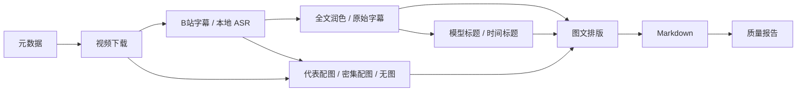

# 架构

正式入口为 `bilidraft` CLI；Skill 的 `scripts/run.py` 只负责定位自身 Python 环境与源码，不复制业务逻辑。配置和任务路径以显式 workspace 为根。

## 模块职责

| 模块 | 职责 |
| --- | --- |
| config / cli / doctor | 严格配置、参数覆盖、只读计划、环境诊断 |
| auth / bilibili / media | 二维码登录、平台 API、视频与音频获取 |
| transcribe | 字幕优先与可选 SenseVoice/VAD |
| polish / llm / structure | 全文编辑、自检及独立规则检查、标题；raw 路径不调用模型 |
| slides / align / exporter | 受控并行配图、段落对齐、Markdown 转义和导出 |
| pipeline / storage / quality | 依赖编排、缓存、锁、原子写入、报告 |

## 数据约束

字幕含唯一整数 ID、文本与有序有效时间。VAD 使用实际时间边界，不伪造零时间戳。润色只允许按原顺序合并连续 ID，首 ID 承载文本，其余空字符串表示被合并；每条原文仍保留在 raw 中。

长度、相似度、ID、数字与句读检查不通过时保留原文，并标记 raw fallback。短句不能仅因长度被删除。数字比较考虑等值中文写法但保留必要告警。模型自检是额外信号，不构成事实保证。

raw 模式直接保留字幕文本、ID 和时间，增加时间标题；报告和正文明确标记未润色。无图模式输出空配图结构，不解码视频。多种模式均保留统一的缓存与报告接口。

输出图片始终保留完整帧尺寸。代表模式按时间窗口稀疏选取候选，使用运动、边缘、哈希与缩略图去重；不保证每页召回。密集模式采用扫描、稳定页与 OCR，仍有误选和漏页可能。对齐保持时间单调，OCR 不足时回退时间位置；正文与附录图片集合不重不漏。

## 并行与恢复

代表配图自动最多四个任务，FFmpeg 每个任务内部线程限制为一，避免线程过量竞争。可选 OCR 每个线程使用独立实例。输出顺序不依赖线程完成顺序。

字幕/ASR 完成后，slides 与 clean/outline 并行；排版等待两路完成。一路失败保留另一条已完成缓存，不导出半份成功结果。报告区分实际等待 wall time 和各线程累计耗时。

每阶段保存输入、代码、参数和产物签名；依赖变化会使相应下游失效。小文件 SHA-256，大视频使用大小与修改时间（性能折中，不是防篡改边界）。raw 模式不把未使用的 LLM 设置加入文本缓存签名。

任务使用 OS 文件锁，JSON/Markdown 用同目录临时文件原子替换。分块结果完成即保存；恢复和失败重试不应重复调用已成功块。Ctrl+C 停止排队工作，已发送的 HTTP 请求仍可能等待结束或超时。

## 扩展边界

ASR、OCR 为可选依赖；无需模型的 raw 模式与云润色共享输出格式。新增后端应维持数据约束、缓存签名和隐私边界。多 P、云 ASR、DOCX/PDF 与 VLM 尚未实现，不能在文档或 Agent 回复中宣称支持。
